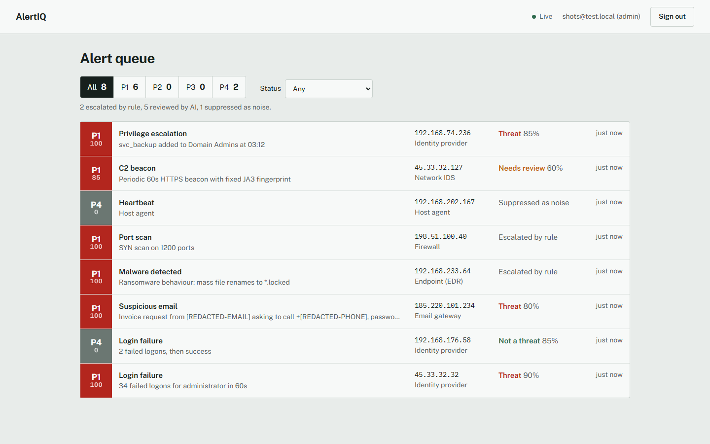
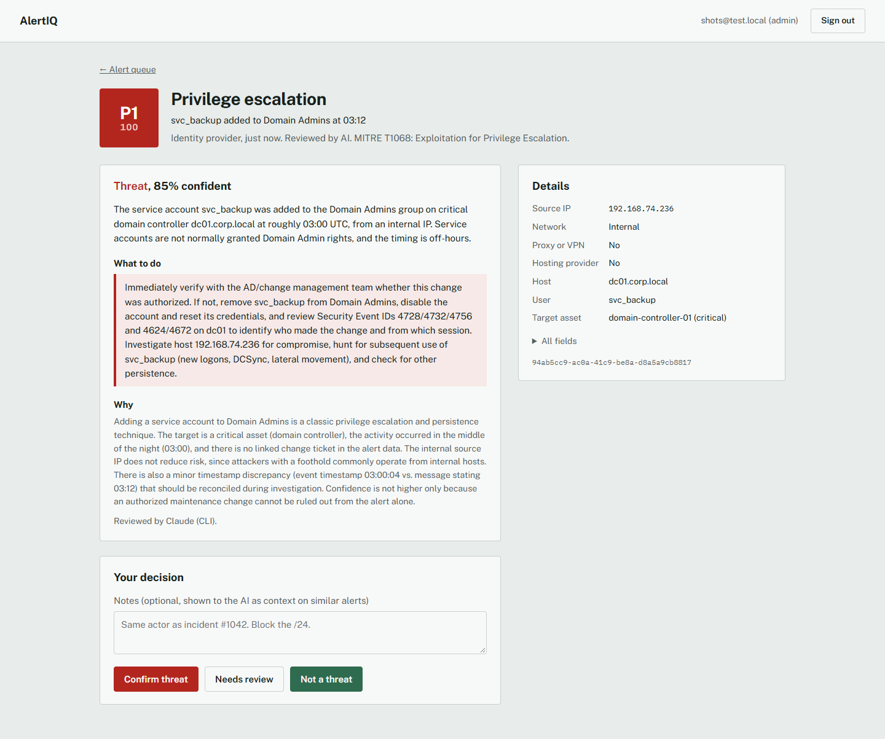

# AlertIQ

AlertIQ sorts security alerts so an analyst sees the ones that need a person first.

Log sources post raw events to an API. Each event is cleaned up, checked against simple rules, stripped of personal data, enriched with IP and asset context, reviewed by Claude (or by built-in rules when no AI is available), scored, and placed in a P1–P4 queue. Analysts work the queue in a web dashboard that updates live, and their decisions are fed back to the AI as examples.



## How an alert moves through it

1. **Ingest.** `POST /alerts/ingest` maps vendor field names to one schema, removes emails, phone numbers, card numbers, SSNs, tokens and passwords, and drops exact repeats seen in the last 5 minutes.
2. **Rules.** Heartbeats and pings are suppressed. Anything marked CRITICAL, or with 50+ attempts, skips the AI and goes straight to P1. A source IP sending 10+ alerts a minute is throttled.
3. **Context.** Public IPs are looked up on ip-api.com (country, network, proxy, hosting). The targeted host or IP is looked up in an asset list to get its criticality.
4. **Review.** Claude returns a verdict (threat, not a threat, needs review), a confidence, a severity, a summary and a recommended action. The reply is validated before it's used.
5. **Score.** Severity, asset criticality and IP risk set the score; the AI verdict pushes it up or down in proportion to its confidence. 80+ is P1, 60+ P2, 40+ P3.
6. **Notify.** P1 and P2 alerts go to Slack if a webhook is set. Every change is pushed to open dashboards over a WebSocket.
7. **Learn.** When an analyst confirms or rejects an alert, the next AI reviews see the five most recent decisions as examples.



## Running it

You need Docker, Python 3.11+ and Node 18+.

```bash
# Postgres
docker run --name alertiq-postgres -e POSTGRES_USER=alertiq -e POSTGRES_PASSWORD=alertiq123 \
  -e POSTGRES_DB=alertiq -p 5432:5432 -d postgres:16

# Backend (Windows: venv\Scripts\activate)
cp .env.example .env
python -m venv venv && source venv/bin/activate
pip install -r requirements.txt
uvicorn backend.main:app --reload --port 8000

# Dashboard
cd frontend && npm install && npm run dev      # http://localhost:3000
```

Open the dashboard and create the admin account (only the first account can sign itself up). Then send some realistic test events:

```bash
python scripts/send_sample_alerts.py
```

Or run everything in containers with `docker compose up --build`.

## Choosing the AI

`AI_PROVIDER=auto` (the default) uses the first of these that's available:

| Provider | Cost | Needs |
|---|---|---|
| `anthropic` | Paid per call | `ANTHROPIC_API_KEY` |
| `claude_cli` | Free with a Claude subscription | Claude Code installed and signed in. Runs `claude -p` with tools turned off. |
| `rules` | Free, offline | Nothing. Deterministic rules give the same kind of verdict. |

`ollama` (a local model) is also supported if you set it explicitly. The alert page says which one reviewed each alert.

## Settings

| Variable | What it does |
|---|---|
| `DATABASE_URL` | Postgres connection string |
| `JWT_SECRET` | Signs login tokens. Set your own; the app warns if it's the default. |
| `INGEST_API_KEY` | If set, ingest requests need the header `X-API-Key` |
| `ALLOW_REGISTRATION` | `true` lets anyone sign up as an analyst. Default `false`: the admin adds users. |
| `AI_PROVIDER`, `ANTHROPIC_API_KEY` | See above |
| `SLACK_WEBHOOK_URL` | Optional Slack alerts for P1 and P2 |
| `DEDUP_WINDOW_SECONDS` | Repeat window, default 300 |
| `CORS_ORIGINS` | Dashboard origins allowed to call the API |

## Roles

- **Admin** can do everything and creates users with `POST /auth/users`.
- **Analyst** can view alerts and record decisions.
- **Read-only** can view alerts.

## API

| Method | Path | |
|---|---|---|
| POST | `/alerts/ingest` | Send a raw event |
| GET | `/alerts`, `/alerts/{id}`, `/alerts/stats` | Read alerts (signed in) |
| PATCH | `/alerts/{id}/verdict` | Record an analyst decision |
| POST | `/auth/register`, `/auth/login`, `/auth/users` | Accounts |
| WS | `/ws/alerts?token=…` | Live updates |

Interactive docs are at http://localhost:8000/docs.

## Tests

```bash
docker exec alertiq-postgres psql -U alertiq -c "CREATE DATABASE alertiq_test"   # once
python -m pytest -q
```

The suite covers the scoring and scrubbing rules and runs the whole flow (accounts, ingest, pipeline, roles, feedback, live updates) against a separate test database using the rules provider, so it's free and repeatable.

## Built with

FastAPI, PostgreSQL (JSONB, plain SQL through psycopg 3), React with Vite, WebSockets, JWT auth, and Claude.
